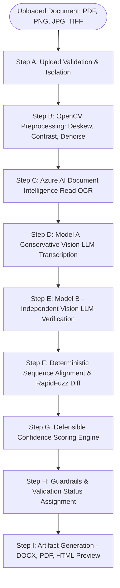

# Handwritten Document Extraction and Confidence Validation System

An enterprise-grade, full-stack application that extracts handwritten text from scanned documents, reconstructs clean typed documents, conducts dual-model forensic verification, deterministically calculates a defensible confidence score, and assigns a strict validation status.

---

## 1. System Architecture



### The 9-Stage Processing Pipeline

1. **Step A (Upload Validation):** Checks magic file signatures (not merely file extensions), enforces size (20MB) and page limits (10 pages), isolates files into per-job temporary directories, and blocks executable payloads.
2. **Step B (Image Preprocessing):** Uses Pillow and OpenCV for orientation correction, bilateral denoising (preserving faint pencil marks and decimal points), deskewing via contour minimum bounding boxes, and CLAHE contrast enhancement.
3. **Step C (Primary OCR):** Executes Azure AI Document Intelligence `prebuilt-read` model. Retains full text, word-level coordinates/polygons, and calculates an exact word-weighted OCR confidence (handling missing confidence scores explicitly without assuming 100%).
4. **Step D (Model A - Transcription Correction):** Vision-capable LLM acts as a conservative transcription specialist. Faithfully reconstructs handwriting, preserves names, dates, amounts, negations, and meaningful paragraphs without hallucinating gaps. Explicitly flags uncertain spans.
5. **Step E (Model B - Independent Verification):** A separately configured vision-capable LLM inspects the original image character by character to detect missing lines, substituted words, altered numbers, or inverted negations. Does NOT assume Model A is correct.
6. **Step F (Sequence Alignment & Diff):** Deterministic comparison engine using RapidFuzz Levenshtein token alignment. Tracks insertions, deletions, substitutions, and scans critical tokens (numbers, dates, proper IDs, and negation words like *not*, *no*, *never*, *without*).
7. **Step G (Confidence Scoring Engine):** Calculates a weighted quality score from verified evidence:
   $$\text{Preliminary Score} = 0.35 \times \text{OCR} + 0.30 \times \text{Verification} + 0.20 \times \text{Alignment} + 0.15 \times \text{Completeness}$$
8. **Step H (Validation Status Guardrails):**
   - **Passed Validation:** Score $\ge 90\%$, all pages processed, zero unresolved critical discrepancies.
   - **Requires Review:** Score $70\%\text{--}89\%$, or any unresolved ambiguity or material discrepancy.
   - **Failed Validation:** Score $< 70\%$, dropped pages, or severe extraction failures.
   - *Guardrail Override:* Any critical discrepancy (e.g. flipped negation or altered dosage) strictly prohibits an automatic pass regardless of the numerical score.
9. **Step I (Document Generation):** Automatically generates typed downloadable **DOCX** (via `python-docx`) and **PDF** (via `reportlab`) documents with highlighted `[UNCLEAR — REVIEW REQUIRED]` markers.

---

## 2. Technology Stack

- **Backend:** Python 3.11+, FastAPI, Pydantic v2, Pillow, OpenCV-headless, RapidFuzz, python-docx, ReportLab, pypdfium2.
- **Frontend:** React 19, TypeScript, Vite, Tailwind CSS, Lucide React icons.
- **AI Integrations:**
  - Azure AI Document Intelligence (`prebuilt-read`)
  - Model A: Vision LLM (`gpt-4o` or Azure OpenAI vision deployment)
  - Model B: Independent Vision LLM (`gpt-4o-mini` or Azure OpenAI vision deployment)
  - Seamless Dev Mode fallback with simulated handwriting extractions when cloud API credentials are not yet configured.

---

## 3. Configuration & Environment Setup

Copy `.env.example` to `.env`:

```bash
cp .env.example .env
```

Edit `.env` to configure your credentials:

```ini
# Azure AI Document Intelligence (Read model)
AZURE_DOCUMENT_INTELLIGENCE_ENDPOINT=https://<your-resource-name>.cognitiveservices.azure.com/
AZURE_DOCUMENT_INTELLIGENCE_KEY=your-azure-key-here
AZURE_DOCUMENT_INTELLIGENCE_API_VERSION=2024-11-30

# Model A (Transcription Correction) - Vision-capable LLM
MODEL_A_PROVIDER=openai
MODEL_A_ENDPOINT=https://api.openai.com/v1
MODEL_A_API_KEY=your-api-key
MODEL_A_DEPLOYMENT=gpt-4o

# Model B (Independent Verification) - Vision-capable LLM
MODEL_B_PROVIDER=openai
MODEL_B_ENDPOINT=https://api.openai.com/v1
MODEL_B_API_KEY=your-api-key
MODEL_B_DEPLOYMENT=gpt-4o-mini

# Operational Limits & Thresholds
MAX_UPLOAD_SIZE_MB=20
MAX_DOCUMENT_PAGES=10
PASS_THRESHOLD=90.0
REVIEW_THRESHOLD=70.0
TEMP_FILE_TTL_HOURS=24
ALLOW_DEV_MOCK_FALLBACK=True
```

---

## 4. Installation & Quick Start

### 1. Backend Setup

```bash
# Navigate to backend directory
cd backend

# Install dependencies
python -m pip install -r requirements.txt

# Run automated test suite
python -m pytest tests -v

# Start FastAPI backend server
python -m uvicorn app.main:app --host 127.0.0.1 --port 8000 --reload
```
The backend API will be live at `http://127.0.0.1:8000` with interactive Swagger docs at `http://127.0.0.1:8000/docs`.

### 2. Frontend Setup

In a separate terminal:

```bash
# Navigate to frontend directory
cd frontend

# Install npm dependencies
npm install

# Start Vite dev server
npm run dev
```
Open your browser at `http://localhost:5173`.

---

## 5. API Endpoints

| Method | Endpoint | Description |
| :--- | :--- | :--- |
| `GET` | `/api/health` | Service health status check |
| `GET` | `/api/documents/config-status` | Safe configuration status of Azure & models |
| `POST` | `/api/documents/upload` | Uploads and validates scanned document |
| `POST` | `/api/documents/{id}/extract` | Initiates the 9-stage extraction pipeline |
| `GET` | `/api/documents/{id}/status` | Polls progress percentage and current step |
| `GET` | `/api/documents/{id}/result` | Retrieves full score, breakdown, and HTML preview |
| `GET` | `/api/documents/{id}/download?format=docx` | Downloads generated Word document (.docx) |
| `GET` | `/api/documents/{id}/download?format=pdf` | Downloads generated PDF document (.pdf) |
| `DELETE` | `/api/documents/{id}` | Permanently removes temporary files and artifacts |

---

## 6. Sample Documents for Testing

Pre-built sample documents with expected transcriptions are provided in `backend/fixtures/`:
- `backend/fixtures/sample-medical-01.png`: Medical consultation note containing cursive handwriting, clinical shorthand, and critical negation clauses (*"Do NOT initiate oral corticosteroids"*).
- `backend/fixtures/sample-contract-02.png`: Equipment addendum with financial figures and conditional terms.

You can drag and drop these sample images directly into the web UI to verify the full end-to-end extraction and validation workflow.
